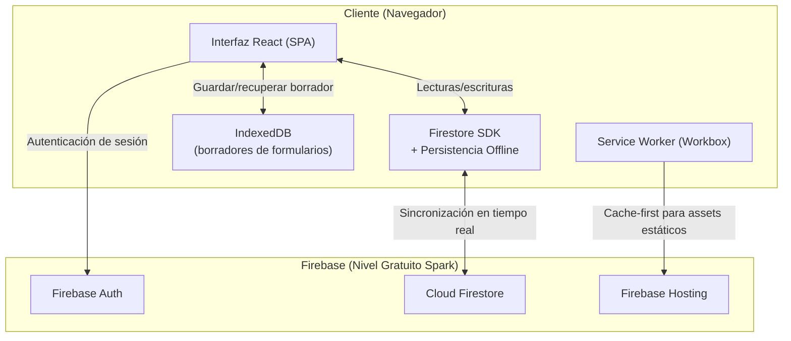
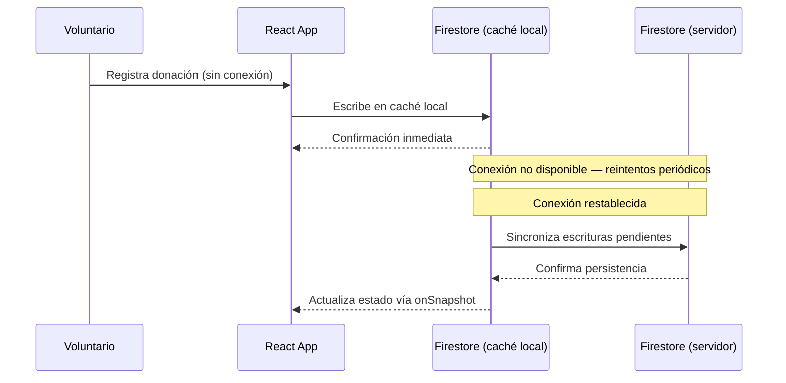
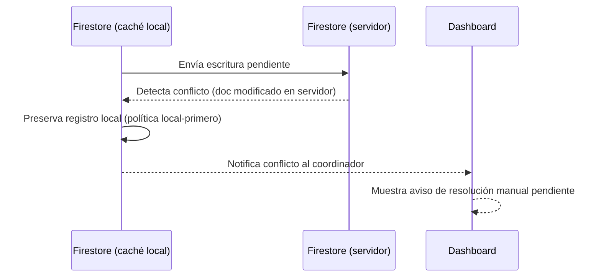
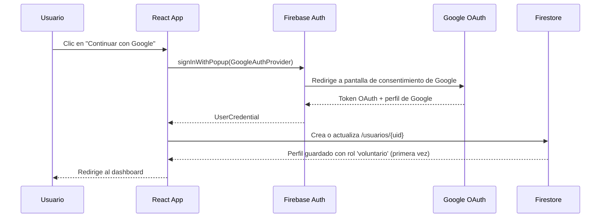
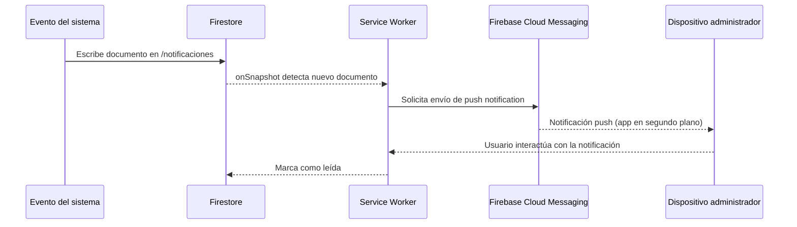
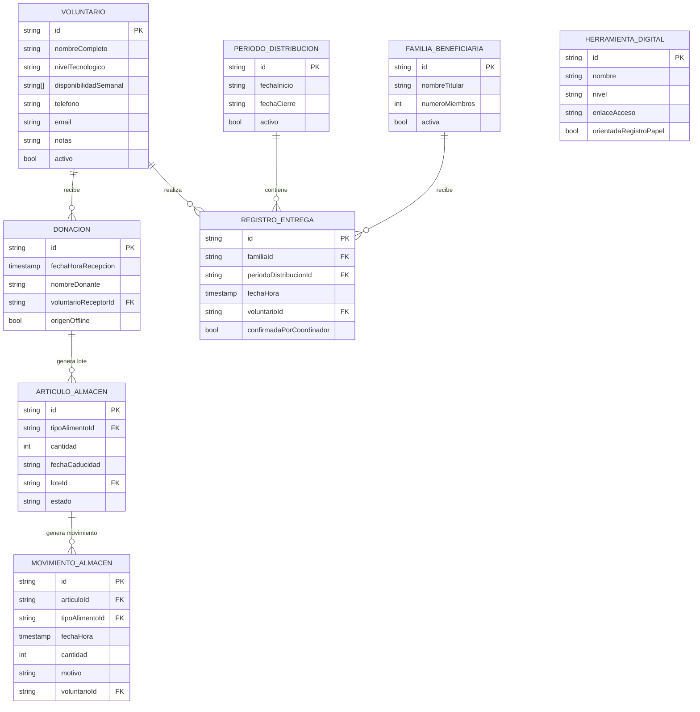

# Documento de Diseño Técnico

## Sistema de Gestión del Banco de Alimentos de Barrio

---

## Overview

El sistema es una **Aplicación Web Progresiva (PWA)** de página única (SPA) que funciona íntegramente desde el navegador sin instalación, diseñada para voluntarios con distintos niveles de experiencia tecnológica. El diseño prioriza la simplicidad extrema de la interfaz, el funcionamiento sin conexión y el coste cero de operación.

### Decisiones de diseño principales

| Decisión | Elección | Justificación |
|---|---|---|
| Tipo de app | PWA (SPA) | Sin instalación, funciona en móviles y ordenadores, soporte offline nativo |
| Backend / Base de datos | Firebase Firestore (nivel gratuito Spark) | Sincronización offline automática, tiempo real, sin coste para el volumen esperado |
| Autenticación | Firebase Authentication + GoogleAuthProvider (nivel gratuito) | Sin coste, OAuth 2.0 con Google, sin contraseña local, soporta roles vía custom claims |
| Almacenamiento offline | Firestore Persistence + IndexedDB | Caché automática de Firestore; datos de formularios en progreso en IndexedDB |
| Framework de UI | React + Vite (SPA) | Ecosistema maduro, PWA plugin gratuito, rendimiento adecuado en gama baja |
| CSS | Tailwind CSS (build gratuito) | Clases utilitarias, fácil mantener botones ≥44 px, diseño responsivo |
| Despliegue | Firebase Hosting (nivel gratuito) | Integración directa con Firestore, HTTPS automático, CDN global |
| Generación de PDF | jsPDF (gratuito, cliente) | Generación de recibos fiscales directamente en el navegador sin dependencias de servidor |
| Notificaciones push | Firebase Cloud Messaging — FCM (gratuito) | Envío de push notifications sin coste mediante Service Worker existente |
| Tipografía | Inter (Google Fonts, gratuita) | Legible, moderna, excelente soporte para interfaces multilingües y pantallas de baja resolución |
| Testing de propiedades | fast-check (JavaScript/TypeScript) | Librería PBT madura, gratuita, compatible con Vitest |
| Testing unitario | Vitest + React Testing Library | Coste cero, integración directa con Vite |

### Restricciones respetadas

- **Coste cero**: Firebase Spark ofrece 1 GB de almacenamiento Firestore y 50.000 lecturas/día, suficiente para un banco de alimentos de barrio típico.
- **Sin instalación**: PWA accesible desde navegador; opcionalmente instalable en pantalla de inicio.
- **Offline obligatorio**: Firestore Persistence (IndexedDB) sincroniza automáticamente al recuperar la conexión.
- **Accesibilidad**: botones ≥ 44×44 px, etiquetas de texto en todos los controles, contraste mínimo AA (WCAG 2.1).
- **Idioma**: interfaz en español; no se requieren otras lenguas en el alcance actual.

---

## Design System & Visual Identity

Esta sección define el sistema de diseño visual del sistema: paleta de colores, tipografía, iconografía, componentes visuales clave y micro-interacciones. Su objetivo es garantizar coherencia visual, accesibilidad y una experiencia de uso sencilla para voluntarios de cualquier nivel tecnológico.

### Paleta de colores

| Token | Valor hex | Uso principal |
|---|---|---|
| **Verde Esperanza** (primario) | `#2D7D46` | Botones principales, iconos de acción, encabezados |
| **Verde Claro** (secundario) | `#52C27A` | Hover states, badges activos, indicadores positivos |
| **Naranja Cálido** (alerta) | `#F4A023` | Alertas de escasez, "Próximo a caducar" |
| **Rojo Suave** (urgencia) | `#E05252` | Artículos caducados, alertas urgentes, errores |
| **Azul Tranquilo** (información) | `#3B82F6` | Notificaciones informativas, enlaces |
| **Crema / Fondo claro** | `#FAFAF5` | Fondo general de pantallas |
| **Blanco tarjeta** | `#FFFFFF` | Fondo de tarjetas y modales |
| **Gris Texto** | `#374151` | Texto principal |
| **Gris Suave** | `#9CA3AF` | Texto secundario, placeholders |
| **Degradado hero** (login) | `linear-gradient(135deg, #2D7D46 0%, #52C27A 100%)` | Fondo de la pantalla de inicio de sesión |

### Tipografía

- **Fuente principal**: `Inter` (Google Fonts, gratuita) — legible, moderna, excelente para interfaces
- **Importación**: `@import url('https://fonts.googleapis.com/css2?family=Inter:wght@400;500;600&display=swap')`

| Uso | Clase Tailwind | Tamaño |
|---|---|---|
| Títulos de sección | `text-2xl font-semibold` | 24px |
| Subtítulos | `text-lg font-medium` | 18px |
| Cuerpo / etiquetas | `text-base font-normal` | 16px |
| Texto secundario | `text-sm` | 14px |
| Texto de botones | `text-base font-semibold` | 16px |

- **Line-height**: 1.6 para cuerpo de texto, 1.3 para títulos

### Iconografía

Se usa **Heroicons** (gratuito, SVG, compatible con Tailwind CSS). Cada sección del sistema tiene un icono distintivo para facilitar la orientación de voluntarios no técnicos:

| Sección | Icono Heroicons |
|---|---|
| Voluntarios | `UserGroupIcon` |
| Donaciones | `HeartIcon` |
| Almacén | `ArchiveBoxIcon` |
| Entregas | `TruckIcon` |
| Catálogo | `BookOpenIcon` |
| Dashboard | `ChartBarIcon` |
| Notificaciones | `BellIcon` |
| Recibos Fiscales | `DocumentTextIcon` |
| Configuración | `Cog6ToothIcon` |

### Componentes visuales clave

#### Tarjetas de métricas (Dashboard)
- Fondo: `#FFFFFF`
- Sombra: `shadow-md`
- Borde izquierdo: 4px sólido en el color de la categoría (verde para positivos, naranja para alertas, rojo para urgencias)
- Border-radius: `rounded-xl`

#### Badges de estado de caducidad

| Estado | Fondo | Texto | Decoración |
|---|---|---|---|
| `Normal` | `#E8F5E9` | `#2D7D46` | — |
| `Próximo a caducar` | `#FEF3C7` | `#D97706` | — |
| `Urgente` | `#FEE2E2` | `#E05252` | Ícono de campana con `animate-pulse` |
| `Caducado` | `#F3F4F6` | `#6B7280` | Texto tachado (`line-through`) |

#### Barra de navegación
- Fondo: `#2D7D46`
- Texto e iconos: blancos (`#FFFFFF`)
- Indicador de sección activa: fondo `rgba(255, 255, 255, 0.15)` con `rounded-md`

#### Botón primario
- Fondo: `#2D7D46` | Texto: blanco | Border-radius: `rounded-lg`
- Hover: `#245F36` | Tamaño mínimo: 44×44px
- Clase Tailwind base: `bg-[#2D7D46] text-white rounded-lg hover:bg-[#245F36] min-h-[44px] min-w-[44px] font-semibold`

#### Botón secundario
- Borde: `1px solid #2D7D46` | Texto: `#2D7D46` | Fondo: transparente
- Hover: fondo `#E8F5E9`

#### Pantalla de inicio de sesión
- Fondo: degradado `linear-gradient(135deg, #2D7D46 0%, #52C27A 100%)`
- Tarjeta central: fondo blanco, `rounded-2xl`, `shadow-xl`, centrada en pantalla
- Logo: icono de corazón + espiga (compuesto con Heroicons)
- Botón de Google: diseño oficial de Google (logo SVG + texto "Continuar con Google"), fondo blanco, borde gris

### Animaciones y micro-interacciones

| Elemento | Animación |
|---|---|
| Hover de botones y tarjetas | Transición `150ms ease-in-out` en color de fondo y sombra |
| Badge "Urgente" | `animate-pulse` de Tailwind (parpadeo suave) |
| Banners de notificación | Deslizamiento desde arriba: `transition-transform translate-y` de `-100%` a `0` en `200ms` |
| Carga de datos (skeleton) | Bloques gris suave con `animate-pulse` en lugar de spinner genérico |

---

## Architecture

### Diagrama de alto nivel



### Flujo de sincronización offline



### Flujo de detección y resolución de conflictos



### Estructura de directorios del proyecto

```
src/
├── main.tsx                     # Punto de entrada React + Firebase init
├── firebase/
│   ├── config.ts                # Claves públicas de Firebase
│   └── persistence.ts           # Habilita persistencia Firestore offline
├── features/
│   ├── voluntarios/             # Requisito 1
│   │   ├── ListaVoluntarios.tsx
│   │   ├── FormularioVoluntario.tsx
│   │   ├── SemanaVoluntarios.tsx
│   │   └── voluntariosService.ts
│   ├── donaciones/              # Requisito 2
│   │   ├── WizardDonacion.tsx
│   │   ├── AlertaCaducidad.tsx
│   │   ├── HistorialDonante.tsx
│   │   ├── ListaDonaciones.tsx
│   │   └── donacionesService.ts
│   ├── almacen/                 # Requisito 3
│   │   ├── InventarioFEFO.tsx
│   │   ├── EtiquetaCaducidad.tsx
│   │   ├── MovimientoAlmacen.tsx
│   │   ├── InformeCaducados.tsx
│   │   └── almacenService.ts
│   ├── entregas/                # Requisito 4
│   │   ├── BuscadorFamilia.tsx
│   │   ├── EstadoEntrega.tsx
│   │   ├── FormularioEntrega.tsx
│   │   ├── ListaPendientes.tsx
│   │   ├── InformePeriodo.tsx
│   │   └── entregasService.ts
│   ├── catalogo/                # Requisito 5
│   │   ├── CatalogoHerramientas.tsx
│   │   ├── TarjetaHerramienta.tsx
│   │   ├── SeccionRecomendada.tsx
│   │   └── catalogoService.ts
│   ├── dashboard/               # Requisito 6
│   │   ├── PanelPrincipal.tsx
│   │   ├── IndicadorMetrica.tsx
│   │   ├── AlertaEscasez.tsx
│   │   ├── AlertaUrgente.tsx
│   │   ├── FallbackDatos.tsx
│   │   └── dashboardService.ts
│   ├── auth/                    # Requisito 8
│   │   ├── PantallaLogin.tsx
│   │   ├── BotonGoogle.tsx
│   │   ├── ProtectedRoute.tsx
│   │   └── authService.ts
│   ├── recibos/                 # Requisito 9
│   │   ├── GeneradorRecibo.tsx
│   │   ├── HistorialRecibos.tsx
│   │   ├── VisorRecibo.tsx
│   │   └── recibosService.ts
│   └── notificaciones/          # Requisito 10
│       ├── CentroNotificaciones.tsx
│       ├── BannerNotificacion.tsx
│       ├── ListaNotificaciones.tsx
│       └── notificacionesService.ts
├── shared/
│   ├── components/
│   │   ├── BotonPrimario.tsx
│   │   ├── MensajeConfirmacion.tsx
│   │   └── MensajeError.tsx
│   ├── hooks/
│   │   ├── useFirestore.ts
│   │   ├── useOfflineStatus.ts
│   │   └── useSessionTimeout.ts
│   └── utils/
│       ├── fefo.ts              # Lógica de ordenación FEFO
│       ├── fechas.ts            # Utilidades de fechas y caducidad
│       └── validaciones.ts      # Funciones de validación de formularios
├── service-worker.ts            # Workbox: cache-first para assets estáticos
└── tests/
    ├── unit/                    # Vitest + React Testing Library
    └── property/                # fast-check (tests de propiedades)
```

---

## Components and Interfaces

### 1. Módulo de Voluntarios (`features/voluntarios/`)

| Componente / Servicio | Responsabilidad |
|---|---|
| `ListaVoluntarios` | Tabla filtrable por nivel tecnológico; muestra nombre, nivel y tareas asignadas |
| `FormularioVoluntario` | Crear y editar voluntarios; detecta duplicados por nombre y contacto |
| `SemanaVoluntarios` | Vista semanal: voluntarios activos de la semana, permite actualizar la lista |
| `voluntariosService` | CRUD de voluntarios en Firestore; función de detección de duplicados |

**Interfaces TypeScript:**

```typescript
interface Voluntario {
  id: string;                        // Autogenerado por Firestore
  nombreCompleto: string;            // Máx. 100 caracteres
  contacto: Contacto;                // Al menos uno de los dos campos obligatorio
  nivelTecnologico: NivelTecnologico;
  disponibilidadSemanal: DiaSemana[]; // Al menos un día
  notas?: string;                    // Máx. 500 caracteres
  activo: boolean;
  creadoEn: Timestamp;
}

type NivelTecnologico = 'Basico' | 'Intermedio' | 'Avanzado';

type DiaSemana =
  | 'lunes' | 'martes' | 'miercoles' | 'jueves'
  | 'viernes' | 'sabado' | 'domingo';

interface Contacto {
  telefono?: string;                 // Máx. 15 dígitos
  email?: string;                    // Máx. 254 caracteres
}

// Funciones de servicio relevantes
function detectarDuplicado(nuevo: Voluntario, existentes: Voluntario[]): boolean;
function filtrarPorNivel(voluntarios: Voluntario[], nivel: NivelTecnologico): Voluntario[];
function validarNotas(notas: string): boolean; // true si notas.length <= 500
```

### 2. Módulo de Donaciones (`features/donaciones/`)

| Componente / Servicio | Responsabilidad |
|---|---|
| `WizardDonacion` | Formulario multipaso (≤5 pasos) para registrar donación |
| `AlertaCaducidad` | Modal de confirmación si algún artículo ya caducó |
| `HistorialDonante` | Muestra últimas 10 donaciones si el donante tiene ≥2 donaciones previas |
| `ListaDonaciones` | Historial paginado (50 registros/página), ordenado por fecha descendente |
| `donacionesService` | CRUD de donaciones, validación de caducidad, búsqueda de historial de donante |

**Interfaces TypeScript:**

```typescript
interface Donacion {
  id: string;
  fechaHoraRecepcion: Timestamp;    // UTC
  nombreDonante?: string;            // Máx. 100 caracteres; opcional
  articulos: ArticuloDonacion[];     // 1–50 ítems
  voluntarioReceptorId: string;
  registradaEnUTC: Timestamp;
  origenOffline: boolean;
}

interface ArticuloDonacion {
  tipoAlimentoId: string;
  cantidad: number;                  // 1–9.999
  fechaCaducidad: string;            // ISO 8601 (YYYY-MM-DD)
}

// Funciones de servicio relevantes
function validarArticulosCaducados(
  articulos: ArticuloDonacion[],
  hoy: Date
): ArticuloDonacion[];              // Retorna artículos con fechaCaducidad < hoy

function obtenerHistorialDonante(
  nombreDonante: string,
  donaciones: Donacion[]
): Donacion[];                      // Máx. 10, ordenadas de reciente a antiguo

function ordenarPorFechaDescendente(donaciones: Donacion[]): Donacion[];
```

### 3. Módulo de Almacén (`features/almacen/`)

| Componente / Servicio | Responsabilidad |
|---|---|
| `InventarioFEFO` | Lista de artículos ordenada por fecha de caducidad ascendente (FEFO) |
| `EtiquetaCaducidad` | Badge textual: "Urgente" (≤3 días), "Próximo a caducar" (4–7 días), "Caducado" |
| `MovimientoAlmacen` | Registra entrada / salida / descarte con motivo |
| `InformeCaducados` | Genera listado de descartados por caducidad en rango 1–365 días |
| `almacenService` | Ordenación FEFO, clasificación de estado, detección de escasez, generación de informes |

**Interfaces TypeScript:**

```typescript
interface Articulo {
  id: string;
  tipoAlimentoId: string;
  tipoAlimentoNombre: string;
  cantidad: number;
  fechaCaducidad: string;            // ISO 8601 (YYYY-MM-DD)
  loteId: string;                    // Referencia a la Donacion origen
  estado: EstadoArticulo;
}

type EstadoArticulo = 'disponible' | 'reservado' | 'descartado' | 'entregado';

type EstadoCaducidad = 'Normal' | 'ProximoACaducar' | 'Urgente' | 'Caducado';

interface MovimientoAlmacen {
  id: string;
  articuloId: string;
  tipoAlimentoId: string;
  fechaHora: Timestamp;
  cantidad: number;
  motivo: MotivoMovimiento;
  voluntarioId: string;
}

type MotivoMovimiento = 'donacion_recibida' | 'entrega' | 'descarte_caducidad';

interface UmbralEscasez {
  tipoAlimentoId: string;
  tipoAlimentoNombre: string;
  umbral: number;                    // 1–9.999; configurable por coordinador
  coordinadorId: string;
}

// Funciones de servicio relevantes
function ordenarFEFO(articulos: Articulo[]): Articulo[];
function clasificarEstadoCaducidad(fechaCaducidad: string, hoy: Date): EstadoCaducidad;
function detectarEscasez(
  stockActual: number,
  umbral: number
): boolean;
function generarInformeCaducados(
  movimientos: MovimientoAlmacen[],
  inicio: Date,
  fin: Date
): MovimientoAlmacen[];
```

### 4. Módulo de Entregas (`features/entregas/`)

| Componente / Servicio | Responsabilidad |
|---|---|
| `BuscadorFamilia` | Búsqueda de familia por nombre (parcial) o identificador exacto |
| `EstadoEntrega` | Indicador visual diferenciado de si la familia ya recibió entrega en el período |
| `FormularioEntrega` | Prepara entrega con sugerencia FEFO automática; bloquea segunda entrega sin coordinador |
| `ListaPendientes` | Familias sin entrega a ≤24 h del cierre de período |
| `InformePeriodo` | Resumen de entregas realizadas, familias pendientes y artículos distribuidos |
| `entregasService` | Creación de RegistroEntrega, cálculo de progreso, generación de lista de pendientes |

**Interfaces TypeScript:**

```typescript
interface FamiliaBeneficiaria {
  id: string;
  nombreTitular: string;             // Máx. 100 caracteres
  numeroMiembros: number;            // 1–20
  activa: boolean;
}

interface RegistroEntrega {
  id: string;
  familiaId: string;
  periodoDistribucionId: string;
  fechaHora: Timestamp;
  articulosEntregados: ArticuloEntregado[]; // 1–50 artículos
  voluntarioId: string;
  confirmadaPorCoordinador?: boolean;       // Solo si era posible segunda entrega
}

interface ArticuloEntregado {
  articuloId: string;
  tipoAlimentoId: string;
  cantidad: number;
}

interface PeriodoDistribucion {
  id: string;
  fechaInicio: string;               // ISO 8601
  fechaCierre: string;               // ISO 8601
  activo: boolean;
}

// Funciones de servicio relevantes
function buscarFamilia(
  termino: string,
  familias: FamiliaBeneficiaria[]
): FamiliaBeneficiaria[];

function tienEntregaEnPeriodo(
  familiaId: string,
  periodoId: string,
  registros: RegistroEntrega[]
): boolean;

function calcularProgresoPeriodo(
  registros: RegistroEntrega[],
  familias: FamiliaBeneficiaria[]
): { realizadas: number; total: number };

function obtenerPendientesUrgentes(
  familias: FamiliaBeneficiaria[],
  registros: RegistroEntrega[],
  periodo: PeriodoDistribucion,
  ahora: Date
): FamiliaBeneficiaria[];
```

### 5. Módulo de Catálogo (`features/catalogo/`)

| Componente / Servicio | Responsabilidad |
|---|---|
| `CatalogoHerramientas` | Lista filtrable por nivel de dificultad, con sección recomendada |
| `TarjetaHerramienta` | Nombre, descripción (≤80 palabras), nivel, enlace, guía de primeros pasos |
| `SeccionRecomendada` | Herramientas del nivel del voluntario autenticado bajo etiqueta "Recomendado para tu nivel" |
| `catalogoService` | Filtrado, ordenación, validación de herramientas, detección de enlace no disponible |

**Interfaces TypeScript:**

```typescript
interface HerramientaDigital {
  id: string;
  nombre: string;
  descripcion: string;               // Máx. 80 palabras
  nivel: NivelTecnologico;
  enlaceAcceso: string;              // URL válida
  guiaPrimerosPasos: string[];       // 3–5 pasos
  herramientaAlternativaId?: string; // ID de herramienta alternativa si el enlace falla
  orientadaRegistroPapel: boolean;   // true para la herramienta Básica de papel (Req. 5.4)
}

// Funciones de servicio relevantes
function filtrarCatalogoPorNivel(
  herramientas: HerramientaDigital[],
  nivel: NivelTecnologico
): HerramientaDigital[];

function ordenarCatalogoPorNivel(herramientas: HerramientaDigital[]): HerramientaDigital[];

function validarHerramienta(h: HerramientaDigital): boolean;

function verificarEnlaceDisponible(url: string): Promise<boolean>;
```

### 6. Módulo de Dashboard (`features/dashboard/`)

| Componente / Servicio | Responsabilidad |
|---|---|
| `PanelPrincipal` | Cuadrícula responsiva de indicadores; accesible desde cualquier sección en 1 clic |
| `IndicadorMetrica` | Icono + etiqueta ≤4 palabras + valor numérico; navega a sección con filtro al hacer clic |
| `AlertaEscasez` | Lista de tipos de alimento con stock bajo el umbral definido |
| `AlertaUrgente` | Artículos con caducidad ≤3 días (fondo visualmente diferenciado) |
| `FallbackDatos` | Aviso cuando los datos no se han podido cargar; conserva último valor conocido |
| `dashboardService` | Cálculo de las 5 métricas; integración con servicios de almacén, entregas y voluntarios |

**Interfaces TypeScript:**

```typescript
interface MetricasDashboard {
  voluntariosActivosSemana: number;
  totalArticulosAlmacen: number;
  articulosProximosACaducar: number; // Caducidad ≤7 días
  entregasRealizadasPeriodo: number;
  totalFamilias: number;
  articulosDescartadosPeriodo: number;
  ultimaActualizacion: Date;
}

interface IndicadorConfig {
  id: string;
  etiqueta: string;                  // Máx. 4 palabras
  icono: string;                     // Nombre de icono (e.g. Heroicons)
  rutaDestino: string;               // Ruta de navegación al hacer clic
  filtroAplicado?: Record<string, unknown>;
}
```

### 7. Componentes y hooks compartidos (`shared/`)

| Componente / Hook | Responsabilidad |
|---|---|
| `BotonPrimario` | Botón ≥44×44 px con etiqueta de texto obligatoria; no depende solo de icono |
| `MensajeConfirmacion` | Texto en lenguaje cotidiano tras acciones de guardado / borrado / entrega |
| `MensajeError` | Indica campo incorrecto y cómo corregirlo; sin códigos técnicos |
| `useOfflineStatus` | Suscripción a `navigator.onLine` + eventos `online` / `offline` del navegador |
| `useSessionTimeout` | Detecta inactividad 30 min → muestra aviso; a los 35 min → cierra sesión + guarda borrador en IndexedDB |
| `useFirestore` | Wrapper tipado de lecturas/escrituras Firestore con manejo de errores estandarizado |

---

### 8. Módulo de Autenticación Google (`features/auth/`)

| Componente / Servicio | Responsabilidad |
|---|---|
| `PantallaLogin` | Pantalla de inicio de sesión con degradado verde, tarjeta centrada y botón de Google; aplica el Design System |
| `BotonGoogle` | Botón con logo oficial de Google y texto "Continuar con Google"; dispara el flujo OAuth de Firebase |
| `ProtectedRoute` | Componente HOC que redirige a `/login` si no hay sesión activa; comprueba el rol requerido para rutas restringidas |
| `authService` | Inicializa `GoogleAuthProvider`, gestiona `signInWithPopup`, crea o actualiza el perfil de usuario en Firestore, lee y asigna `customClaims` de rol |

**Interfaces TypeScript:**

```typescript
interface UsuarioApp {
  uid: string;
  displayName: string;
  email: string;
  photoURL?: string;
  rol: RolUsuario;
  creadoEn: Timestamp;
  ultimaSesion: Timestamp;
}

type RolUsuario = 'voluntario' | 'coordinador' | 'administrador';

// Funciones de servicio relevantes
function iniciarSesionConGoogle(): Promise<UsuarioApp>;
function cerrarSesion(): Promise<void>;
function obtenerUsuarioActual(): UsuarioApp | null;
function asignarRol(uid: string, rol: RolUsuario): Promise<void>; // Solo administrador
```

**Flujo OAuth detallado:**



**Reglas de rol:**
- Primera autenticación → rol `voluntario` asignado automáticamente
- Un administrador existente puede elevar el rol a `coordinador` o `administrador`; los nuevos permisos se aplican en la siguiente sesión del usuario
- Las rutas protegidas comprueban el rol mediante `customClaims` del token de Firebase, no solo el estado local

---

### 9. Módulo de Recibos Fiscales (`features/recibos/`)

| Componente / Servicio | Responsabilidad |
|---|---|
| `GeneradorRecibo` | Formulario solo visible para el rol `administrador`; selecciona donante y período; desencadena la generación del PDF |
| `HistorialRecibos` | Lista filtrable por donante y año; muestra folio, estado, fecha y enlace de descarga; acceso exclusivo para administrador |
| `VisorRecibo` | Previsualización del recibo antes de descarga; permite marcar como anulado y generar corrección |
| `recibosService` | Genera el PDF con jsPDF, asigna folio secuencial `AÑO-NNN`, guarda el registro en Firestore, gestiona anulación y corrección |

**Interfaces TypeScript:**

```typescript
interface ReciboFiscal {
  id: string;
  folio: string;                    // Formato: AÑO-NNN (ej: 2026-001)
  donacionId: string;
  nombreDonante: string;
  fechaDonacion: string;            // ISO 8601
  articulosDonados: ArticuloDonacion[];
  nombreBanco: string;
  direccionBanco: string;
  fechaGeneracion: Timestamp;
  estado: 'vigente' | 'anulado';
  folioAnterior?: string;           // Solo si es recibo de corrección
  generadoPorUid: string;
}

// Funciones de servicio relevantes
function generarFolioSecuencial(año: number, totalRecibosAño: number): string;
// Retorna "AÑO-NNN" con ceros a la izquierda hasta 3 dígitos, ej: "2026-001"

function generarPDF(recibo: ReciboFiscal): Blob;
// Produce el PDF usando jsPDF con los datos del recibo

function anularRecibo(reciboId: string): Promise<void>;
// Marca el recibo como 'anulado' en Firestore

function obtenerHistorialRecibos(
  filtros: { donante?: string; año?: number }
): Promise<ReciboFiscal[]>;
```

**Estructura del folio:**
- Formato: `AÑO-NNN` donde `NNN` es el número secuencial con ceros a la izquierda (mínimo 3 dígitos)
- Ejemplo: `2026-001`, `2026-012`, `2026-123`
- La secuencia reinicia a `001` cada año natural

---

### 10. Módulo de Notificaciones (`features/notificaciones/`)

| Componente / Servicio | Responsabilidad |
|---|---|
| `CentroNotificaciones` | Panel lateral o modal accesible desde el icono `BellIcon` en la barra superior; lista las últimas 50 notificaciones con indicador de no leídas |
| `BannerNotificacion` | Banner no bloqueante en esquina superior derecha; deslizamiento desde arriba con `transition-transform`; botón "Ver detalle" |
| `ListaNotificaciones` | Subcomponente de `CentroNotificaciones`; permite marcar como leída o descartar cada notificación |
| `notificacionesService` | Escucha en tiempo real la colección `/notificaciones` de Firestore; gestiona agrupación de notificaciones; integra con FCM y Service Worker para push |

**Interfaces TypeScript:**

```typescript
interface Notificacion {
  id: string;
  tipoEvento: TipoEventoNotificacion;
  descripcion: string;
  fechaHora: Timestamp;
  estado: 'no_leida' | 'leida' | 'descartada';
  referenciaRecurso?: string;       // ID del recurso afectado
  referenciaColeccion?: string;     // Nombre de la colección Firestore afectada
  agrupada?: boolean;
  conteoAgrupado?: number;          // Número de notificaciones consolidadas
}

type TipoEventoNotificacion =
  | 'escasez_stock'
  | 'caducidad_urgente'
  | 'segunda_entrega_coordinador'
  | 'conflicto_sincronizacion';

// Funciones de servicio relevantes
function crearNotificacion(
  tipo: TipoEventoNotificacion,
  descripcion: string,
  referenciaRecurso?: string,
  referenciaColeccion?: string
): Promise<Notificacion>;

function agruparNotificaciones(
  notificaciones: Notificacion[],
  intervaloMinutos: number
): Notificacion[];
// Consolida notificaciones del mismo tipoEvento en un intervalo dado

function marcarComoLeida(notificacionId: string): Promise<void>;
function descartarNotificacion(notificacionId: string): Promise<void>;

function suscribirPush(uid: string): Promise<void>;
// Registra el token FCM del dispositivo para recibir push cuando la app no está en primer plano
```

**Estructura de la colección Firestore:**

```
/notificaciones/{notifId}
  Notificacion (id, tipoEvento, descripcion, fechaHora,
                estado, referenciaRecurso, referenciaColeccion,
                agrupada, conteoAgrupado)
```

**Flujo de notificación push (FCM + Service Worker):**



---

## Data Models

### Estructura en Cloud Firestore

```
/ (raíz)
├── voluntarios/{volId}
│     Voluntario (id, nombreCompleto, contacto, nivelTecnologico,
│                 disponibilidadSemanal, notas, activo, creadoEn)
│
├── usuarios/{uid}
│     UsuarioApp (uid, displayName, email, photoURL, rol, creadoEn, ultimaSesion)
│
├── donantes/{donanteId}
│     { nombre: string, totalDonaciones: number }
│
├── donaciones/{donacionId}
│     Donacion (id, fechaHoraRecepcion, nombreDonante, articulos[],
│               voluntarioReceptorId, registradaEnUTC, origenOffline)
│
├── tiposAlimento/{tipoId}
│     { id, nombre, categoría }
│
├── almacen/{articuloId}
│     Articulo (id, tipoAlimentoId, tipoAlimentoNombre, cantidad,
│               fechaCaducidad, loteId, estado)
│
├── movimientosAlmacen/{movId}
│     MovimientoAlmacen (id, articuloId, tipoAlimentoId, fechaHora,
│                        cantidad, motivo, voluntarioId)
│
├── familiasBeneficiarias/{familiaId}
│     FamiliaBeneficiaria (id, nombreTitular, numeroMiembros, activa)
│
├── periodosDistribucion/{periodoId}
│     PeriodoDistribucion (id, fechaInicio, fechaCierre, activo)
│
├── registrosEntrega/{entregaId}
│     RegistroEntrega (id, familiaId, periodoDistribucionId, fechaHora,
│                      articulosEntregados[], voluntarioId,
│                      confirmadaPorCoordinador)
│
├── umbralesEscasez/{tipoAlimentoId}
│     UmbralEscasez (tipoAlimentoId, tipoAlimentoNombre, umbral,
│                    coordinadorId)
│
├── herramientasDigitales/{herramientaId}
│     HerramientaDigital (id, nombre, descripcion, nivel, enlaceAcceso,
│                         guiaPrimerosPasos[], herramientaAlternativaId,
│                         orientadaRegistroPapel)
│
├── recibos/{reciboId}
│     ReciboFiscal (id, folio, donacionId, nombreDonante, fechaDonacion,
│                   articulosDonados[], nombreBanco, direccionBanco,
│                   fechaGeneracion, estado, folioAnterior, generadoPorUid)
│
├── notificaciones/{notifId}
│     Notificacion (id, tipoEvento, descripcion, fechaHora, estado,
│                   referenciaRecurso, referenciaColeccion,
│                   agrupada, conteoAgrupado)
│
└── configuracion/global
      { periodoActivoId: string }
```

### Reglas de seguridad de Firestore (resumen)

Los roles se almacenan en `customClaims` de Firebase Auth (campo `rol: 'coordinador' | 'voluntario' | 'administrador'`).

```
// Lectura general: cualquier usuario autenticado
// Escritura en /voluntarios, /familiasBeneficiarias, /umbralesEscasez,
//              /herramientasDigitales, /periodosDistribucion: solo coordinador
// Escritura en /donaciones, /almacen, /movimientosAlmacen,
//              /registrosEntrega: voluntario autenticado
// Lectura y escritura en /recibos: solo administrador
// Lectura en /notificaciones: solo administrador
// Escritura en /notificaciones: solo el sistema (service account / Functions)
// Lectura y escritura en /usuarios/{uid}: el propio usuario o administrador
```

### Diagrama entidad-relación



---

## Correctness Properties

*Una propiedad es una característica o comportamiento que debe cumplirse en todas las ejecuciones válidas del sistema — esencialmente, una afirmación formal sobre lo que el sistema debe hacer. Las propiedades sirven como puente entre las especificaciones legibles por humanos y las garantías de corrección verificables automáticamente.*

---

### Property 1: Round-trip de persistencia de voluntarios

*Para cualquier* voluntario con datos válidos (nombre ≤100 caracteres, al menos un contacto, nivel tecnológico válido, al menos un día de disponibilidad), guardar el registro y recuperarlo por su ID debe producir un objeto con los mismos valores en todos los campos.

**Validates: Requirements 1.1, 1.2**

---

### Property 2: Unicidad de identificadores de voluntarios

*Para cualquier* conjunto de N voluntarios registrados en el sistema, los N identificadores asignados deben ser todos distintos entre sí.

**Validates: Requirements 1.2**

---

### Property 3: El panel semanal refleja nombre y nivel de cada voluntario activo

*Para cualquier* lista de voluntarios marcados como activos en la semana, el componente de panel semanal renderizado debe contener el nombre completo y la etiqueta textual del nivel tecnológico (Básico, Intermedio o Avanzado) de cada uno de ellos.

**Validates: Requirements 1.4, 1.5**

---

### Property 4: Detección de duplicados de voluntarios

*Para cualquier* par de registros de voluntario donde el nombre completo es idéntico y al menos un dato de contacto coincide, la función de detección de duplicados debe retornar `true`; y para pares donde el nombre difiere o no comparten ningún contacto, debe retornar `false`.

**Validates: Requirements 1.6**

---

### Property 5: Filtrado de voluntarios por nivel tecnológico

*Para cualquier* lista de voluntarios y cualquier nivel de filtro (Básico, Intermedio o Avanzado), la función de filtrado debe retornar exactamente los voluntarios con ese nivel — sin excluir ninguno que lo tenga ni incluir ninguno que no lo tenga.

**Validates: Requirements 1.7**

---

### Property 6: La validación de notas rechaza textos de más de 500 caracteres

*Para cualquier* cadena de texto de longitud > 500 caracteres, la función de validación de notas debe retornar un error indicando que se ha superado el límite; y para cadenas de longitud ≤ 500 caracteres, debe aceptarlas.

**Validates: Requirements 1.8**

---

### Property 7: Detección correcta de artículos caducados en donación entrante

*Para cualquier* artículo cuya `fechaCaducidad` es anterior a la fecha actual del sistema, la función de validación de donación debe clasificarlo como caducado y requerir confirmación explícita del voluntario antes de continuar.

**Validates: Requirements 2.4**

---

### Property 8: Integridad del registro de donación guardada

*Para cualquier* donación guardada (con o sin conexión), recuperarla por su ID debe producir un objeto que contenga el `voluntarioReceptorId`, el timestamp en UTC y todos los artículos con sus cantidades y fechas de caducidad sin pérdida de datos.

**Validates: Requirements 2.5, 3.1**

---

### Property 9: Ordenación descendente del historial de donaciones

*Para cualquier* lista de donaciones recuperada del historial, la función de ordenación debe producir una lista donde la `fechaHoraRecepcion` de cada elemento es mayor o igual a la del elemento siguiente (orden de más reciente a más antigua).

**Validates: Requirements 2.8**

---

### Property 10: Historial de donante recurrente devuelve ≤10 registros del donante correcto

*Para cualquier* nombre de donante con 2 o más donaciones registradas, la función de historial debe retornar un subconjunto de máximo 10 registros, donde todos pertenecen a ese donante y están ordenados de más reciente a más antiguo.

**Validates: Requirements 2.9**

---

### Property 11: Ordenación FEFO del inventario y sugerencia de entrega

*Para cualquier* conjunto de artículos disponibles en el inventario, la función de ordenación FEFO debe producir una lista donde la `fechaCaducidad` de cada elemento es menor o igual a la del elemento siguiente; y cuando se sugieren artículos para una entrega, los primeros sugeridos deben ser los de `fechaCaducidad` más próxima.

**Validates: Requirements 3.2, 3.5**

---

### Property 12: Clasificación correcta del estado de caducidad de un artículo

*Para cualquier* artículo del inventario y cualquier fecha actual del sistema, la función de clasificación debe retornar exactamente uno de estos estados:
- `"Urgente"` si `fechaCaducidad` está entre hoy y los próximos 3 días (inclusive) y el artículo no ha caducado,
- `"ProximoACaducar"` si `fechaCaducidad` está entre 4 y 7 días desde hoy (inclusive),
- `"Caducado"` si `fechaCaducidad` es anterior a hoy,
- `"Normal"` en cualquier otro caso.

No deben existir dos estados asignados simultáneamente al mismo artículo.

**Validates: Requirements 3.3, 3.4, 6.4**

---

### Property 13: Alerta de escasez cuando el stock está bajo el umbral

*Para cualquier* par `(stockActual, umbral)` donde `stockActual < umbral`, la función de detección de escasez debe incluir ese tipo de alimento en la lista de alertas con su nombre y cantidad actual; y para pares donde `stockActual >= umbral`, no debe incluirlo.

**Validates: Requirements 3.8, 6.3**

---

### Property 14: Round-trip de movimiento de almacén

*Para cualquier* movimiento de almacén con datos válidos aleatorios (cualquier combinación de tipo de artículo, cantidad 1–9.999, motivo y voluntarioId), guardar y recuperar el movimiento por su ID debe producir un objeto con los mismos valores en los campos: `fechaHora`, `cantidad`, `tipoAlimentoId` y `motivo`.

**Validates: Requirements 3.9**

---

### Property 15: Filtrado correcto del informe de artículos caducados

*Para cualquier* conjunto de movimientos con `motivo = "descarte_caducidad"` y cualquier rango de fechas `[inicio, fin]` válido (1–365 días), el informe debe incluir exactamente los movimientos cuya `fechaHora` está dentro del rango — sin omitir ninguno incluido ni añadir ninguno fuera del rango.

**Validates: Requirements 3.10**

---

### Property 16: Round-trip de persistencia de familia beneficiaria

*Para cualquier* familia beneficiaria con datos válidos (nombre ≤100 caracteres, miembros entre 1 y 20), guardar y recuperar por ID debe producir un objeto con los mismos valores en todos los campos.

**Validates: Requirements 4.1**

---

### Property 17: Búsqueda de familia por nombre o identificador

*Para cualquier* lista de familias beneficiarias y cualquier término de búsqueda, la función de búsqueda debe incluir en los resultados todas las familias cuyo `nombreTitular` contiene el término (búsqueda parcial, insensible a mayúsculas) o cuyo `id` coincide exactamente — y no debe incluir familias que no cumplan ninguno de los dos criterios.

**Validates: Requirements 4.2**

---

### Property 18: Unicidad de entrega por familia y período sin intervención del coordinador

*Para cualquier* conjunto de `RegistrosEntrega`, no deben existir dos registros con el mismo `familiaId` y `periodoDistribucionId` a menos que el segundo tenga el campo `confirmadaPorCoordinador = true`. La función de validación debe bloquear el registro de una segunda entrega para la misma familia en el mismo período si no hay confirmación del coordinador.

**Validates: Requirements 4.4, 4.9**

---

### Property 19: Lista de familias pendientes urgentes antes del cierre de período

*Para cualquier* familia beneficiaria activa sin `RegistroEntrega` en el período actual, en cualquier instante en que la diferencia entre `fechaCierre` del período y la fecha/hora actual sea ≤ 24 horas, la función de pendientes urgentes debe incluir a esa familia en la lista.

**Validates: Requirements 4.5**

---

### Property 20: Integridad del RegistroEntrega creado al confirmar una entrega

*Para cualquier* entrega válida confirmada con datos aleatorios, el `RegistroEntrega` creado debe contener todos los campos requeridos: `familiaId`, `periodoDistribucionId`, `fechaHora`, al menos un artículo en `articulosEntregados`, y `voluntarioId`.

**Validates: Requirements 4.6**

---

### Property 21: Cálculo correcto del progreso de entregas del período

*Para cualquier* conjunto de `RegistrosEntrega` en un período y cualquier padrón de familias activas, la función de progreso debe retornar como numerador el número de familias distintas con al menos un registro en el período, y como denominador el número total de familias activas — sin contar duplicados de familia.

**Validates: Requirements 4.7**

---

### Property 22: El catálogo cubre los tres niveles de dificultad

*Para cualquier* catálogo de herramientas digitales válido, la función de validación del catálogo debe verificar que existe al menos una herramienta con nivel `"Basico"`, al menos una con `"Intermedio"` y al menos una con `"Avanzado"`.

**Validates: Requirements 5.1**

---

### Property 23: Ordenación del catálogo coloca primero las herramientas Básicas

*Para cualquier* catálogo de herramientas, la función de ordenación debe producir una lista donde todas las herramientas de nivel Básico preceden a las Intermedias, y estas preceden a las Avanzadas, sin mezclar herramientas de distintos niveles.

**Validates: Requirements 5.2**

---

### Property 24: Validación de estructura de herramienta del catálogo

*Para cualquier* herramienta del catálogo, la función de validación debe aceptar aquellas cuya descripción tiene ≤80 palabras, la guía de primeros pasos tiene entre 3 y 5 pasos, el enlace es una URL con formato válido, y el nivel es uno de los tres valores permitidos; y debe rechazar las que incumplan cualquiera de esas condiciones.

**Validates: Requirements 5.3**

---

### Property 25: Filtrado del catálogo y sección recomendada son consistentes

*Para cualquier* catálogo de herramientas y cualquier nivel de filtro, la función de filtrado debe retornar exactamente las herramientas con ese nivel — ni más ni menos. La sección recomendada para un voluntario con un nivel dado debe ser idéntica al resultado de aplicar el filtro por ese mismo nivel.

**Validates: Requirements 5.5, 5.6**

---

### Property 26: Las métricas del dashboard reflejan el estado real del sistema

*Para cualquier* estado del sistema (número de voluntarios activos, artículos en almacén, artículos próximos a caducar, entregas realizadas frente al total de familias, artículos descartados), las funciones de cálculo de métricas del dashboard deben retornar valores que coincidan exactamente con los derivados de los datos subyacentes.

**Validates: Requirements 6.2**

---

### Property 27: Las etiquetas de indicadores del dashboard tienen como máximo 4 palabras

*Para cualquier* indicador del dashboard, el texto de su etiqueta visible debe contener 4 palabras o menos (sin contar valores numéricos).

**Validates: Requirements 6.6**

---

### Property 28: La validación de formularios retorna mensajes de error específicos por campo

*Para cualquier* conjunto de datos de formulario que contenga al menos un valor inválido (campo requerido vacío, valor fuera de rango permitido, formato incorrecto), la función de validación debe retornar al menos un mensaje de error que identifique el nombre del campo incorrecto y describa cómo corregirlo, sin incluir códigos de error técnicos.

**Validates: Requirements 7.4**

---

### Property 29: Preservación del borrador de formulario al cerrar sesión por inactividad

*Para cualquier* estado de formulario en progreso guardado en IndexedDB antes de cerrar la sesión por inactividad, al volver a iniciar sesión el borrador recuperado debe ser idéntico al estado guardado (mismos campos y valores), sin pérdida ni modificación de datos.

**Validates: Requirements 7.7**

---

### Property 30: Unicidad y secuencialidad de folios de recibo fiscal

*Para cualquier* año natural y número N de recibos ya emitidos en ese año, la función generadora de folios debe retornar un folio con formato `AÑO-NNN` donde `NNN` es `N+1` formateado con ceros a la izquierda hasta un mínimo de 3 dígitos; y para cualquier conjunto de N folios generados en el mismo año, los N valores deben ser todos distintos entre sí.

**Validates: Requirements 9.3**

---

### Property 31: Integridad estructural de toda notificación generada

*Para cualquier* evento del sistema que genere una notificación, el documento `Notificacion` resultante debe contener todos los campos requeridos con valores válidos: `tipoEvento` perteneciente a los valores permitidos, `descripcion` no vacía, `fechaHora` presente, y `estado` igual a `'no_leida'` en el momento de creación.

**Validates: Requirements 10.8**

---

### Property 32: Agrupación correcta de notificaciones del mismo tipo en intervalo de 10 minutos

*Para cualquier* conjunto de N notificaciones (N ≥ 2) del mismo `tipoEvento` generadas en un intervalo de tiempo ≤ 10 minutos, la función de agrupación debe producir exactamente una notificación consolidada cuyo campo `conteoAgrupado` sea igual a N y cuyo campo `agrupada` sea `true`; para notificaciones del mismo tipo separadas por más de 10 minutos, la función no debe agruparlas.

**Validates: Requirements 10.6**

---

## Error Handling

### Principios generales

- Todos los mensajes de error se muestran en lenguaje cotidiano, sin códigos técnicos ni términos como "null", "undefined" o "500".
- Los errores de validación señalan el campo específico y describen cómo corregirlo.
- Los errores de red no bloquean la operación cuando el sistema puede funcionar offline.
- Los errores inesperados nunca exponen stack traces al usuario.

### Tabla de escenarios de error

| Escenario | Comportamiento del sistema |
|---|---|
| Artículo con fecha de caducidad pasada al registrar donación | Modal de alerta con lista de artículos afectados; requiere confirmación explícita o cancelación. El formulario conserva todos los datos introducidos. |
| Intento de doble entrega a la misma familia en el período | Aviso de alerta, bloqueo del registro, requiere confirmación explícita del coordinador. Sin coordinador disponible, la operación se cancela y el RegistroEntrega existente no se modifica. |
| Stock de un tipo de alimento igual a 0 durante preparación de entrega | Mensaje informativo: "No hay existencias de [nombre del alimento]"; el artículo no se incluye en la sugerencia de entrega. |
| Voluntario duplicado detectado (nombre + al menos un contacto coincide) | Modal de aviso con datos del registro existente; el coordinador decide si guardar el nuevo registro o cancelar. El formulario conserva los datos introducidos si se cancela. |
| Pérdida de conexión durante uso | Badge "Sin conexión" en la barra superior; las operaciones de escritura continúan en modo offline mediante Firestore Persistence. |
| Conflicto de sincronización al recuperar la conexión | Notificación en el dashboard al coordinador; el registro local prevalece sobre el servidor. Queda registrado como pendiente de revisión manual. |
| Datos del dashboard no disponibles al cargar | Se conservan los últimos valores conocidos con sello de fecha/hora; aviso textual visible: "Los datos pueden no estar actualizados." |
| Enlace de herramienta digital no disponible (HTTP 4xx/5xx) | Se muestra el nombre y enlace de la herramienta alternativa del mismo nivel definida en `herramientaAlternativaId`. |
| Sesión inactiva 30 minutos | Modal no intrusivo: "¿Sigues ahí? Tu sesión cerrará en 5 minutos." Botón "Seguir trabajando" detiene el contador. |
| Sesión cerrada por inactividad (35 min sin respuesta) | Redirección a pantalla de inicio; el borrador del formulario en progreso se guarda automáticamente en IndexedDB para recuperación al volver a iniciar sesión. |
| Validación de formulario fallida | Mensaje debajo de cada campo incorrecto indicando qué se espera y cómo corregirlo. El botón de guardar permanece desactivado hasta corregir todos los errores. |
| Error interno inesperado | Mensaje genérico en lenguaje cotidiano: "Algo salió mal. Por favor, inténtalo de nuevo. Si el problema continúa, avisa al coordinador." Sin stack trace ni detalles técnicos. |

---

## Testing Strategy

### Enfoque dual

El sistema usa **dos capas de testing complementarias**:

1. **Tests de ejemplo (unitarios e integración)**: verifican comportamientos concretos, flujos específicos y puntos de integración entre componentes.
2. **Tests de propiedades (property-based testing)**: verifican propiedades universales que deben cumplirse para cualquier entrada válida, ejecutando cientos de iteraciones con datos generados aleatoriamente.

Ambas capas son necesarias y se complementan: los tests de ejemplo detectan bugs concretos y verifican flujos completos; los tests de propiedades verifican la corrección general con entradas que los desarrolladores no habrían considerado manualmente.

### Librería de property-based testing

Se usa **[fast-check](https://fast-check.dev/)** (JavaScript/TypeScript), integrada con **Vitest**. Es gratuita, de código abierto y compatible con el stack elegido (React + Vite).

- Cada test de propiedad se ejecuta con un **mínimo de 100 iteraciones** (`numRuns: 100`).
- Cada test de propiedad debe incluir un comentario de etiqueta con el formato:

```typescript
// Feature: banco-alimentos-barrio, Propiedad N: <texto breve de la propiedad>
```

### Tests de propiedades (fast-check + Vitest)

Cada una de las 32 propiedades definidas en la sección anterior se implementa como un test de propiedad independiente. A continuación se muestran ejemplos de generadores y tests representativos:

```typescript
import fc from 'fast-check';
import { describe, it } from 'vitest';

// --- Generadores reutilizables ---

const nivelArb = fc.constantFrom('Basico', 'Intermedio', 'Avanzado');
const diaSemanaArb = fc.constantFrom(
  'lunes', 'martes', 'miercoles', 'jueves',
  'viernes', 'sabado', 'domingo'
);

const contactoArb = fc.oneof(
  fc.record({ telefono: fc.string({ minLength: 7, maxLength: 15 }) }),
  fc.record({ email: fc.emailAddress() }),
  fc.record({
    telefono: fc.string({ minLength: 7, maxLength: 15 }),
    email: fc.emailAddress(),
  })
);

const voluntarioArb = fc.record({
  nombreCompleto: fc.string({ minLength: 1, maxLength: 100 }),
  contacto: contactoArb,
  nivelTecnologico: nivelArb,
  disponibilidadSemanal: fc.subarray(
    ['lunes','martes','miercoles','jueves','viernes','sabado','domingo'],
    { minLength: 1 }
  ),
  activo: fc.boolean(),
});

const fechaISOArb = fc.date().map(d => d.toISOString().split('T')[0]);

const articuloArb = fc.record({
  tipoAlimentoId: fc.uuid(),
  tipoAlimentoNombre: fc.string({ minLength: 1, maxLength: 60 }),
  cantidad: fc.integer({ min: 1, max: 9999 }),
  fechaCaducidad: fechaISOArb,
  estado: fc.constant('disponible' as const),
});

const familiaBeneficiariaArb = fc.record({
  nombreTitular: fc.string({ minLength: 1, maxLength: 100 }),
  numeroMiembros: fc.integer({ min: 1, max: 20 }),
  activa: fc.constant(true),
});

const herramientaArb = fc.record({
  nombre: fc.string({ minLength: 1, maxLength: 80 }),
  descripcion: fc.string({ minLength: 1, maxLength: 400 }),    // ~80 palabras máx
  nivel: nivelArb,
  enlaceAcceso: fc.webUrl(),
  guiaPrimerosPasos: fc.array(fc.string({ minLength: 5 }), { minLength: 3, maxLength: 5 }),
  orientadaRegistroPapel: fc.boolean(),
});

// --- Ejemplos de tests de propiedad ---

describe('Propiedad 5 — Filtrado de voluntarios por nivel', () => {
  it('retorna exactamente los voluntarios del nivel solicitado', () => {
    // Feature: banco-alimentos-barrio, Propiedad 5: Filtrado de voluntarios por nivel tecnológico
    fc.assert(
      fc.property(
        fc.array(voluntarioArb, { minLength: 0, maxLength: 50 }),
        nivelArb,
        (voluntarios, nivel) => {
          const resultado = filtrarPorNivel(voluntarios, nivel);
          return (
            resultado.every(v => v.nivelTecnologico === nivel) &&
            voluntarios.filter(v => v.nivelTecnologico === nivel).length === resultado.length
          );
        }
      ),
      { numRuns: 100 }
    );
  });
});

describe('Propiedad 11 — Ordenación FEFO', () => {
  it('la lista ordenada tiene fechas de caducidad ascendentes', () => {
    // Feature: banco-alimentos-barrio, Propiedad 11: Ordenación FEFO del inventario
    fc.assert(
      fc.property(
        fc.array(articuloArb, { minLength: 1, maxLength: 200 }),
        (articulos) => {
          const ordenados = ordenarFEFO(articulos);
          for (let i = 0; i < ordenados.length - 1; i++) {
            if (ordenados[i].fechaCaducidad > ordenados[i + 1].fechaCaducidad) return false;
          }
          return true;
        }
      ),
      { numRuns: 100 }
    );
  });
});

describe('Propiedad 12 — Clasificación de estado de caducidad', () => {
  it('cada artículo recibe exactamente un estado de caducidad', () => {
    // Feature: banco-alimentos-barrio, Propiedad 12: Clasificación correcta del estado de caducidad
    fc.assert(
      fc.property(articuloArb, fc.date(), (articulo, hoy) => {
        const estado = clasificarEstadoCaducidad(articulo.fechaCaducidad, hoy);
        const posibles = ['Normal', 'ProximoACaducar', 'Urgente', 'Caducado'];
        return posibles.includes(estado);
      }),
      { numRuns: 100 }
    );
  });
});

describe('Propiedad 18 — Unicidad de entrega por familia y período', () => {
  it('bloquea la segunda entrega sin confirmación del coordinador', () => {
    // Feature: banco-alimentos-barrio, Propiedad 18: Unicidad de entrega por familia y período
    fc.assert(
      fc.property(
        fc.uuid(),   // familiaId
        fc.uuid(),   // periodoId
        (familiaId, periodoId) => {
          const registros = [{ id: 'r1', familiaId, periodoDistribucionId: periodoId } as RegistroEntrega];
          const resultado = validarSegundaEntrega(familiaId, periodoId, registros, false);
          return resultado.bloqueado === true;
        }
      ),
      { numRuns: 100 }
    );
  });
});
```

```typescript
describe('Propiedad 30 — Unicidad y secuencialidad de folios de recibo fiscal', () => {
  it('genera folios únicos con formato AÑO-NNN para N recibos en el mismo año', () => {
    // Feature: banco-alimentos-barrio, Propiedad 30: Unicidad y secuencialidad de folios de recibo fiscal
    fc.assert(
      fc.property(
        fc.integer({ min: 2024, max: 2099 }),   // año
        fc.integer({ min: 0, max: 997 }),        // totalRecibosEmitidos
        (año, totalEmitidos) => {
          const folio = generarFolioSecuencial(año, totalEmitidos);
          const partes = folio.split('-');
          if (partes.length !== 2) return false;
          const [añoFolio, numero] = partes;
          return (
            añoFolio === String(año) &&
            numero.length >= 3 &&
            parseInt(numero, 10) === totalEmitidos + 1
          );
        }
      ),
      { numRuns: 100 }
    );
  });
});

describe('Propiedad 31 — Integridad estructural de notificaciones generadas', () => {
  it('toda notificación creada contiene los campos requeridos con valores válidos', () => {
    // Feature: banco-alimentos-barrio, Propiedad 31: Integridad estructural de toda notificación generada
    const tipoEventoArb = fc.constantFrom(
      'escasez_stock',
      'caducidad_urgente',
      'segunda_entrega_coordinador',
      'conflicto_sincronizacion'
    );
    fc.assert(
      fc.property(
        tipoEventoArb,
        fc.string({ minLength: 1, maxLength: 200 }),   // descripcion
        fc.option(fc.uuid()),                           // referenciaRecurso
        (tipoEvento, descripcion, referenciaRecurso) => {
          const notif = construirNotificacion(tipoEvento, descripcion, referenciaRecurso ?? undefined);
          const tiposValidos = [
            'escasez_stock', 'caducidad_urgente',
            'segunda_entrega_coordinador', 'conflicto_sincronizacion'
          ];
          return (
            tiposValidos.includes(notif.tipoEvento) &&
            notif.descripcion.length > 0 &&
            notif.fechaHora !== undefined &&
            notif.estado === 'no_leida'
          );
        }
      ),
      { numRuns: 100 }
    );
  });
});

describe('Propiedad 32 — Agrupación correcta de notificaciones en intervalo de 10 minutos', () => {
  it('consolida N notificaciones del mismo tipo en intervalo ≤10 min en una sola', () => {
    // Feature: banco-alimentos-barrio, Propiedad 32: Agrupación correcta de notificaciones del mismo tipo
    const tipoEventoArb = fc.constantFrom(
      'escasez_stock', 'caducidad_urgente',
      'segunda_entrega_coordinador', 'conflicto_sincronizacion'
    );
    fc.assert(
      fc.property(
        tipoEventoArb,
        fc.integer({ min: 2, max: 20 }),   // número de notificaciones a agrupar
        (tipo, n) => {
          const ahora = Date.now();
          // Todas en el mismo instante (intervalo 0 min, ≤10 min)
          const notificaciones = Array.from({ length: n }, (_, i) => ({
            id: String(i),
            tipoEvento: tipo,
            descripcion: `Evento ${i}`,
            fechaHora: new Date(ahora + i * 1000) as unknown as Timestamp,
            estado: 'no_leida' as const,
          }));
          const agrupadas = agruparNotificaciones(notificaciones, 10);
          return (
            agrupadas.length === 1 &&
            agrupadas[0].agrupada === true &&
            agrupadas[0].conteoAgrupado === n
          );
        }
      ),
      { numRuns: 100 }
    );
  });
});
```

### Tests de ejemplo y aceptación (Vitest + React Testing Library)

| Área | Casos de test de ejemplo |
|---|---|
| Formulario de voluntario | Guardar voluntario válido; rechazar nombre vacío; rechazar voluntario sin ningún contacto; modal de duplicado aparece al detectar coincidencia |
| Wizard de donación | Flujo completo de ≤5 pasos; alerta de artículo caducado bloquea hasta confirmar; cancelación conserva datos introducidos |
| Almacén | Artículo con stock 0 no aparece en sugerencia de entrega; umbral de escasez configurable y visible en dashboard |
| Entregas | Segunda entrega en mismo período bloquea sin coordinador; lista de pendientes muestra familias a ≤24 h del cierre |
| Catálogo | Al menos una herramienta por nivel; herramienta orientada a papel existe; sección recomendada coincide con nivel del voluntario |
| Dashboard | Clic en indicador navega a sección correcta con filtro aplicado; fallback muestra últimos datos con aviso cuando la carga falla |
| Autenticación | Botón de Google visible en `/login`; primera sesión asigna rol `voluntario`; ruta protegida redirige a login sin sesión activa; nombre y foto aparecen en barra de navegación tras autenticación exitosa |
| Recibos fiscales | Solo el administrador ve el formulario de generación; folio generado tiene formato correcto; recibo anulado se marca en historial; enlace de descarga funciona sin software adicional |
| Notificaciones | Banner aparece en esquina superior derecha ante evento crítico; marcar como leída actualiza el indicador; notificaciones push llegan con app en segundo plano (test manual); agrupación visible cuando hay varios eventos del mismo tipo |
| Sesión | Aviso aparece a los 30 min de inactividad; sesión se cierra a los 35 min; borrador recuperado tras nuevo inicio de sesión |
| Accesibilidad | Todos los botones de acción principal tienen dimensiones ≥44×44 px en el DOM |

### Tests de integración

| Escenario | Herramienta |
|---|---|
| Donación offline → sincronización automática al recuperar conexión | Vitest + mock de conectividad (`navigator.onLine`) |
| Incorporación de artículos al inventario en ≤3 s tras confirmar donación | Vitest + Firebase Emulator Suite (gratuito) |
| Actualización del stock tras retirada de artículo en ≤5 s | Vitest + Firebase Emulator Suite |
| Conflicto de sincronización: registro local prevalece sobre servidor | Vitest + mock de Firestore con conflicto simulado |
| Enlace de herramienta no disponible → muestra herramienta alternativa del mismo nivel | Vitest + mock de `fetch` que retorna error HTTP |
| Flujo OAuth de Google: autenticación exitosa crea perfil en Firestore con rol `voluntario` | Vitest + mock de `firebase/auth` |
| Acceso a ruta de recibos sin rol `administrador` → redirige a dashboard | Vitest + React Testing Library + mock de `customClaims` |
| Generación de PDF de recibo → descarga en el navegador sin software adicional | Vitest + mock de jsPDF |
| Notificación de escasez de stock → documento creado en `/notificaciones` en Firestore | Vitest + Firebase Emulator Suite |
| Compatibilidad de navegadores (Chrome, Firefox, Safari, Edge — últimas 2 versiones) | BrowserStack (plan gratuito con limitaciones) / pruebas manuales |

### Cobertura objetivo

- **Lógica de negocio pura** (FEFO, clasificación de caducidad, detección de duplicados, filtros, validaciones, cálculos de métricas, generación de folios, agrupación de notificaciones): **100 % de propiedades cubiertas con fast-check**.
- **Componentes de UI críticos** (wizard de donación, formulario de entrega, dashboard): **tests de ejemplo para cada flujo principal**.
- **Integración con Firebase**: **Firebase Emulator Suite** en CI para las operaciones de escritura/lectura con restricciones de tiempo.

### Configuración de fast-check y Vitest

```typescript
// vitest.config.ts
import { defineConfig } from 'vitest/config';

export default defineConfig({
  test: {
    globals: true,
    environment: 'jsdom',
    setupFiles: ['./src/tests/setup.ts'],
  },
});
```

```typescript
// Patrón estándar para todos los tests de propiedad
fc.assert(
  fc.property(/* arbitrarios */, (/* parámetros */) => {
    // Feature: banco-alimentos-barrio, Propiedad N: <descripción>
    // ... lógica del test
    return /* condición booleana */;
  }),
  { numRuns: 100 }
);
```
